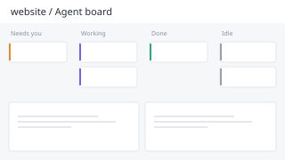
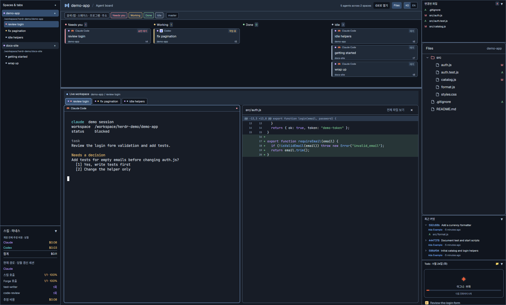
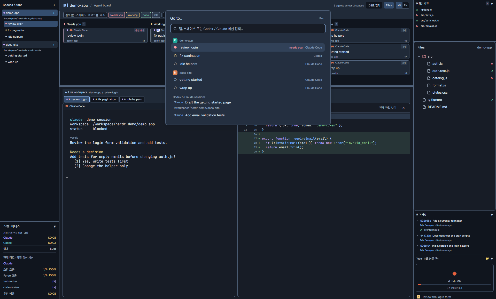
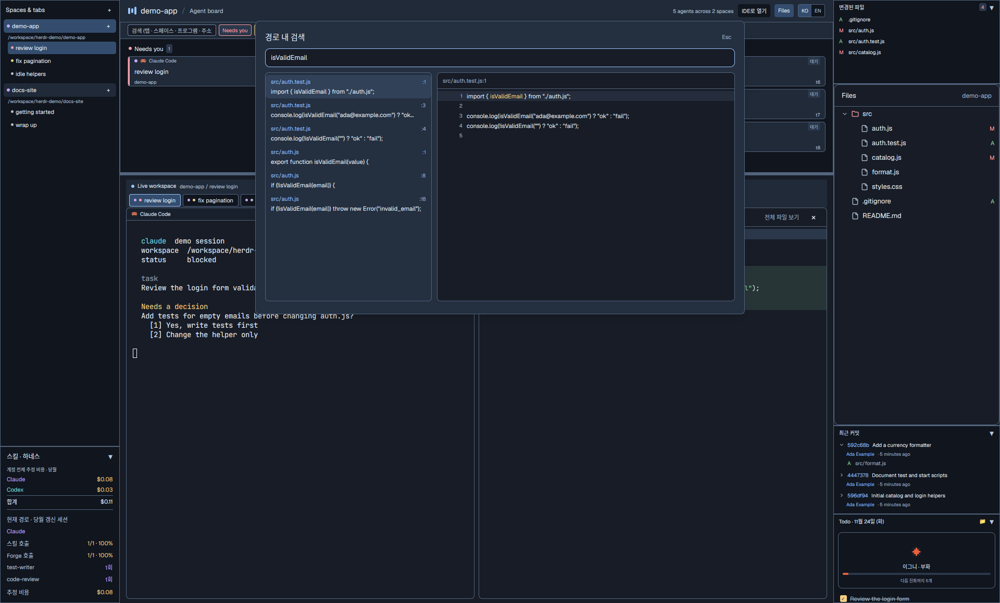
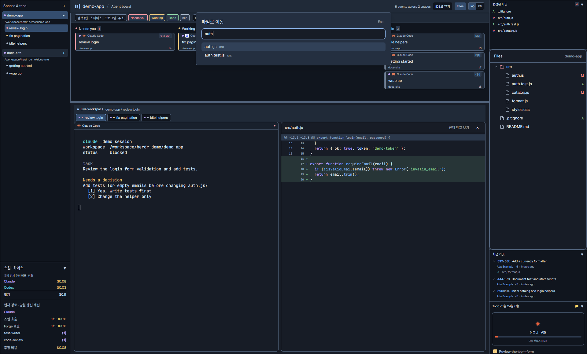
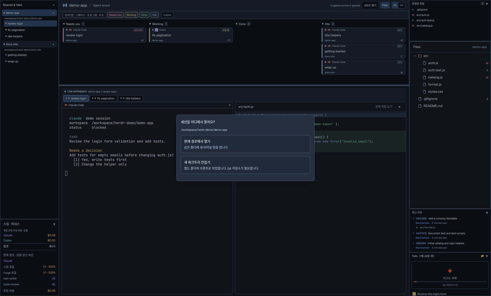

# herdr-agent-board

A custom **"board"** layout for [Herdr](https://herdr.dev) — a kanban-style
view of every agent terminal (Claude Code, Codex, ...) across all your
spaces, plus a set of small panels for day-to-day review work: what
changed, what it costs, and where to open it next.



## What it looks like



Spaces and the skill/cost panel sit on the left; the kanban, path tabs,
live terminal and diff take the center; changed files, the file tree,
recent commits and today's todo sit on the right. The screenshot is a
filled demo workspace (`demo-app` / `docs-site`) — a few agent sessions,
uncommitted changes, and a short commit history — not a production
machine.

```
┌─ Spaces & tabs ─┬──────────── Agent board ─────────────┬─ Files ──────┐
│                 │ Needs you │ Working │ Done │ Idle     │ Changed     │
│  space list     │  (filter bar: text / status / branch) │ files       │
│                 ├───────────────────────────────────────┤             │
│  스킬·하네스     │   path tabs (⌘1-9)                    │ file tree   │
│  사용량 + 비용   │   live terminal / diff preview         │             │
│                 │                                        │ recent      │
│                 │                                        │ commits     │
└─────────────────┴────────────────────────────────────────┴─────────────┘
```

## Features

- **Agent board** — every agent across every space, grouped into
  Needs you / Working / Done / Idle columns, with a filter bar
  (free-text search, status toggles, worktree-branch toggles) and a
  stable per-branch color dot so the same worktree always tags the same
  way.
- **Path tabs** — the same tab, across every space on the current
  machine, as quick-jump pills; `⌘1`-`⌘9` jump straight to the Nth one.
- **변경된 파일 (Changed files)** — every uncommitted change in the
  focused repo in one flat list (no digging through the file tree);
  click a row to see its diff.
- **Diff viewer** — clicking a changed file renders a real diff (`git
  diff HEAD`) with colored +/- backgrounds, old/new line numbers, and a
  lightweight per-language syntax highlighter (comments, strings,
  numbers, keywords) — not just a flat text dump. A toggle switches
  between the diff and the full current file.
- **파일 탐색기 (Files)** — a lazy file tree with git status marks
  (M/A/D/U) on files *and* on collapsed folders that contain changes,
  click-to-browser-open for `.html`/`.htm` (with an explicit source-view
  button too).
- **최근 커밋 (Recent commits)** — the last 30 commits in the focused
  repo; expand one to see its changed files, click to preview the
  current working-tree version.
- **스킬·하네스 사용량 (Skill/harness usage + cost)** — for both Claude
  Code and Codex CLI: how many of the last month's sessions used a Skill
  or Forge, the top skills by call count, and an **estimated dollar
  cost** for the current project and for the whole account, broken down
  by engine (Claude Code vs Codex), computed from each session's token
  usage against published per-model rates.
- **IDE로 열기 (Open in IDE)** — a header button that opens the current
  space's folder in IntelliJ IDEA, Rider, Cursor, or VS Code (`open -a`
  on macOS, the CLI launcher on Windows/Linux).
- **경로 내 검색 (Find in Path)** — search the focused repo and preview
  matching lines in a split popup, then jump to the file.
- **파일로 이동 (Go to File)** — type a path fragment to open a file from the
  focused repo.
- **Todo** — today's checklist from a folder of markdown todo files,
  shown under the commit timeline.
- **세션 추가** — start a new tab in the current folder, or in a new git
  worktree.
- **KO / EN** — a header toggle switches the board chrome between Korean
  and English.
- **Worktree-aware** — spaces/tabs that are git worktrees get a color
  tag derived from their branch name, shared across the sidebar, path
  tabs, and filter bar.


## Screenshots

### Agent board, diff, and side panels

The main shot above is the everyday view. Click a changed file (or a
file in a commit) and the center-right pane shows a real `git diff HEAD`
— colored +/- rows, old/new line numbers, and a light syntax highlighter
— or toggle **전체 파일 보기** for the current file. The changed-files list is
a flat view of every uncommitted path; the file tree underneath is lazy
and marks `M`/`A`/`D`/`U` on files and on collapsed folders that contain
changes.

### Picker



`⌘P` (the `board-picker` binding in `keys.json`) jumps to a space, a
tab, or a recent Codex/Claude session.

### Find in Path



Search the focused repo. Matches are grouped by file; the right pane
previews the selected hit.

### Go to File



Type a path fragment to filter files in the focused repo and open one.

### New session



The session dialog offers a new tab in the current folder, or a new
worktree when you want a branch of its own.

## Layout

| File | What it is |
|---|---|
| `layouts/board.json` | the whole window: sidebar, header, kanban grid, live terminal / diff split, file sidebar |
| `themes/board-readable-dark.json` | the dark theme this layout uses |

## Mods

| Mod | Role |
|---|---|
| `mods/board` | kanban grid, sidebar, header, path tabs, pane header, filter bar |
| `mods/board-changes` | flat list of every uncommitted change |
| `mods/board-files` | lazy file tree with git status marks and html open-in-browser |
| `mods/board-preview` | diff viewer / full-file preview (shared by board-files, board-changes, board-timeline) |
| `mods/board-timeline` | recent commit log with expandable file lists |
| `mods/board-usage` | Claude/Codex skill & forge usage + estimated cost |
| `mods/board-ide-menu` | the "IDE로 열기" popup |
| `mods/board-menu` | right-click context menu for spaces/tabs |
| `mods/board-picker` | `⌘P` mod/agent picker |
| `mods/board-session` | new-session / worktree dialog |
| `mods/board-worktree` | worktree base helper shared by the above |
| `mods/board-todo` | today's markdown todo list under the commit timeline |
| `mods/board-find-in-path` | repo-wide search with a split preview |
| `mods/board-goto-file` | jump to a file by path fragment |
| `mods/board-common` | single source of the shared limits, virtual-scroll math, panel state and `git status` helper (not a mod itself). Herdr only lets a mod import files inside its own folder, so each mod gets a byte-for-byte copy in `mods/<mod>/_common/` — edit `board-common`, then run `node scripts/sync-common.mjs`; a test fails if a copy drifts |

Only this layout and these mods are tracked here — Herdr's own shipped
layouts and mods (`main`, `terminals`, `win98`, `spaces`, `agents`, ...)
are rewritten by Herdr on every start, so they're intentionally left out
(see `.gitignore`).

## Installing

Copy into your Herdr home (`~/.config/herdr-app` by default, see
`HERDR_APP_HOME`):

```sh
git clone https://github.com/nowgnas/herdr-agent-board.git /tmp/herdr-agent-board
cp -R /tmp/herdr-agent-board/layouts/board.json ~/.config/herdr-app/layouts/
cp -R /tmp/herdr-agent-board/themes/board-readable-dark.json ~/.config/herdr-app/themes/
cp -R /tmp/herdr-agent-board/mods/board*/ ~/.config/herdr-app/mods/
herdr-app do layout.switch --name board
```

Then add these bindings to your own `keys.json` under a `"layout:board"`
section (not tracked here, since it's a single shared file):

```json
{
  "layout:board": {
    "cmd-p": "mod.open:board-picker",
    "cmd-d": "board.grid-split",
    "cmd-shift-b": "layout.toggle:board-files-column",
    "cmd-1": "board.path-tab-1",
    "cmd-2": "board.path-tab-2",
    "cmd-3": "board.path-tab-3",
    "cmd-4": "board.path-tab-4",
    "cmd-5": "board.path-tab-5",
    "cmd-6": "board.path-tab-6",
    "cmd-7": "board.path-tab-7",
    "cmd-8": "board.path-tab-8",
    "cmd-9": "board.path-tab-9"
  }
}
```

## Notes

- `board-usage`'s cost numbers are **estimates** from published per-model
  token pricing, not your actual bill — Codex pricing in particular uses
  one flat approximate rate since no per-model rate table was available.
- The usage/cost scan shells out to `python3`; the diff/changed-files/
  timeline panels shell out to `git`.
- `herdr-app check mods/<name>` validates each mod after any edit — see
  Herdr's own `AGENTS.md` for the full authoring reference.

## Limits, caches, polling

- **Changed files / diff limits** — the changed-files list shows the first
  200 entries, then `+N개 더` up to 5,000 (the same cap as the file tree's
  marks); anything past that is counted but not listed. A diff is read at
  most 400,000 characters (cut while reading via `head -c`, not after) and
  shows up to 5,000 lines with `+N줄 더`. Long lists and diffs only build the
  rows on screen (virtual scroll with the mouse wheel; shift+wheel scrolls a
  diff sideways). All limits live in `mods/board-common/limits.js` (copied into each mod's `_common/`).
- **Shared `git status`** — the changed-files panel and the file tree share
  one `git rev-parse`/`git status --untracked-files=all` per repo (cached a
  few seconds), instead of each running its own. In-flight runs and TTLs live
  in module memory; the shared `board.git.status` snapshot is only rewritten
  when the result actually changes (a shared-state write refreshes and saves
  every mod), and a late result never replaces a newer one.
- **Usage estimate cache** — `board-usage` keeps per-session-file aggregates
  (cost, skill names, used-or-not flags; file names and folders only as
  hashes) in `~/.cache/herdr-agent-board/usage-v2.json` (or
  `$XDG_CACHE_HOME/herdr-agent-board/`, or `$HERDR_AGENT_BOARD_CACHE`).
  Unchanged files (same mtime and size) aren't re-read; the cache resets
  each month. Delete the file any time; it's rebuilt on the next refresh.
- **Polling stops when hidden** — the changed-files, recent-commits, todo
  and usage panels stop polling while collapsed, and the file panels while
  the Files sidebar is hidden; they refresh right away when reopened.
- **Session picker** lists the 200 most recent Codex/Claude sessions, with
  `세션 더 보기` to load more.
- Tests use only the standard library and Node built-ins:
  `node --test tests/*.test.mjs` and `python3 -m unittest discover -s tests`.
